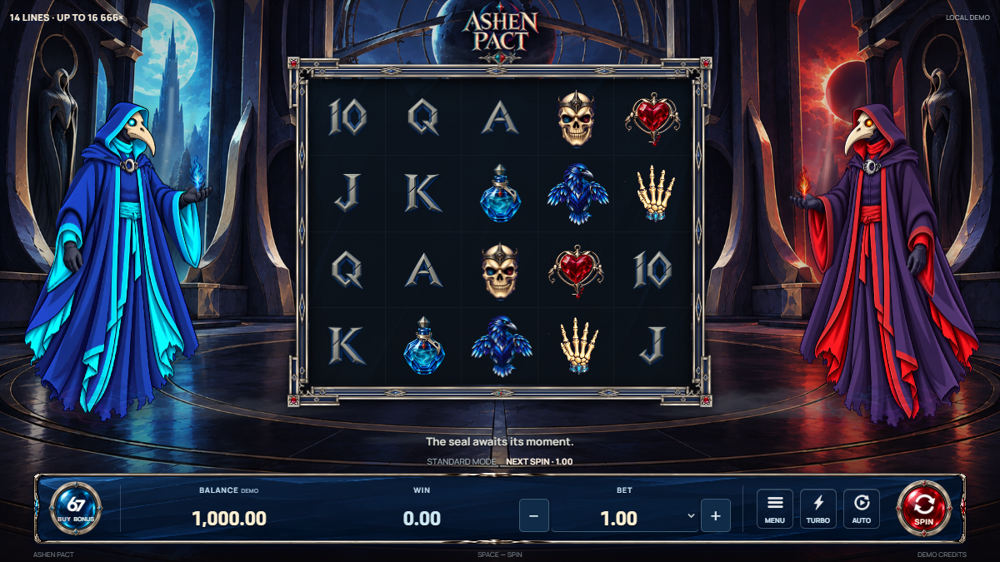
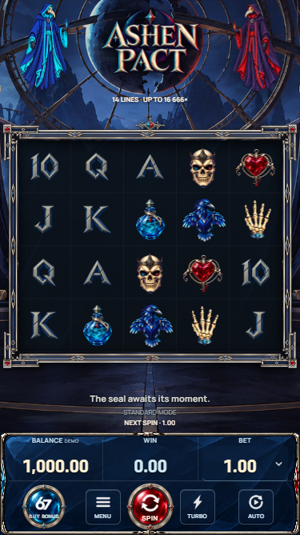

# ASHEN PACT — The Raven's Ritual

A dark fantasy slot interface with two animated raven keepers, a 5 × 4 reel grid, 14 paylines, seal-wheel reveals and three ritual bonus tiers.



This portfolio export contains the active `src/ashen` application and review19 runtime artwork. The screenshots show the local demo with virtual credits.

## Stack and features

- React 19, TypeScript, Vite 7 and Spine 4.2 Canvas rendering.
- Independent game-state logic, RGS response validation, unfinished-round recovery and replay handling.
- Raster symbols, animated characters, curtains, wheel outcomes, scene transitions and win celebrations.
- Desktop and portrait controls, keyboard dialog focus, reduced-motion handling and animation pause/resume on hidden tabs.
- Unit tests for engine accounting, session handling, localization and animation clocks; mathematical tooling under `math/ashen`.

## Run locally

Use Node.js 24 or newer:

```sh
npm ci
npm run dev
npm run build
npm test
```

Without RGS launch parameters the application uses a **local virtual-credit demonstration model**. It is not the published weighted outcome library and does not establish certified RTP. The production outcome books, seeds, QA archives, source-art files and platform credentials are omitted. Server play requires an authorized RGS session.

The exported active source matches the corresponding review19 build-source hashes. This does not claim live platform approval, real-money operation or certified performance on physical phones. Preserved reference-game code and reference audio are excluded.



## Rights and credits

See [LICENSE_NOTICE.md](LICENSE_NOTICE.md) and [LICENSES](LICENSES). Music: **Deep Humidity — TinyWorlds (CC0)**. Interface sounds: **Kenney (CC0)**. Raster illustrations were prepared with AI-assisted workflows; Spine and fonts retain their own licenses. No open-source license is granted for the project-specific code or proprietary artwork.
